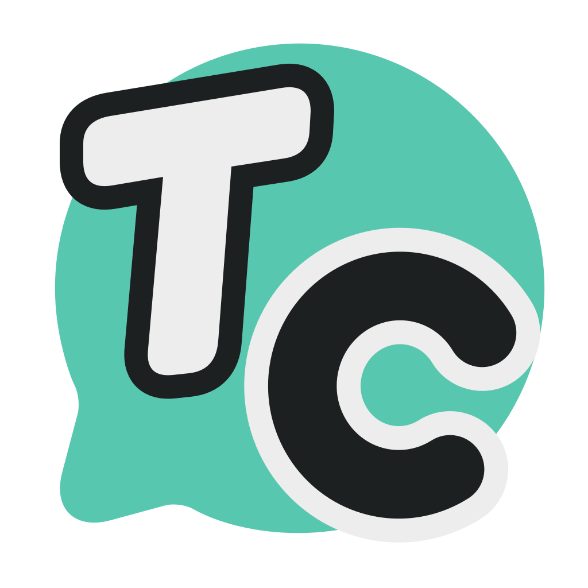
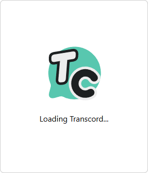
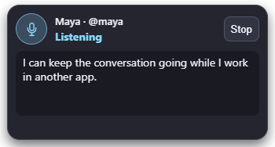
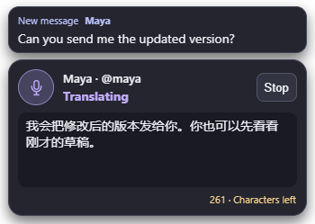
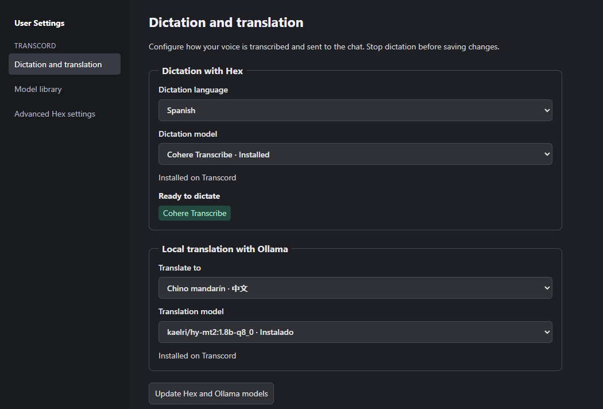
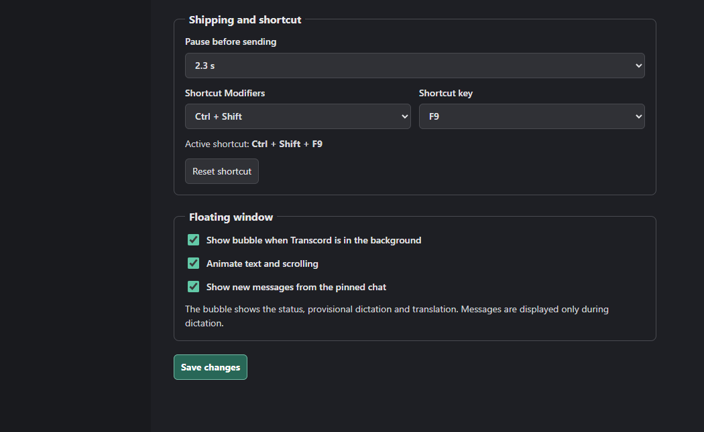
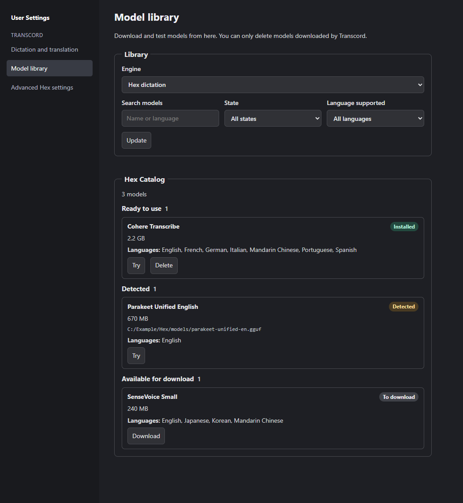
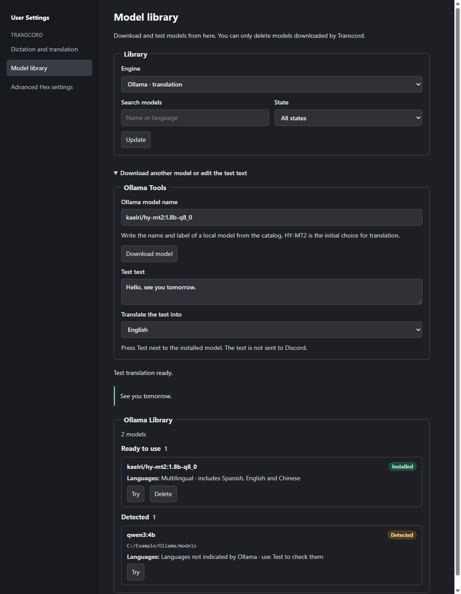
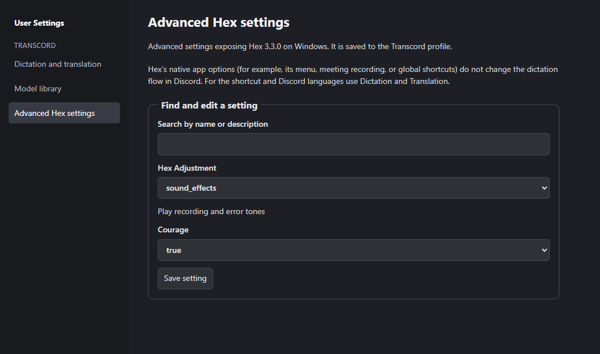

<p align="center">
  
</p>

<h1 align="center">Transcord</h1>

<p align="center">Local voice dictation and optional translation for Discord on Windows.</p>

This is a personal-use project I built for a specific workflow: leave a Discord conversation open, switch to another app, and reply by speaking without switching back. That may be too specific to be useful to most people. If you also dictate replies while doing something else, it might be useful to you.

Transcord combines [Vesktop](https://github.com/Vencord/Vesktop) and its [Vencord](https://github.com/Vendicated/Vencord) plugins with [Hex](https://github.com/anomalyco/hex) for local speech recognition and optional [Ollama](https://github.com/ollama/ollama) translation. I wanted to keep the Discord client and plugins I already used, while managing dictation, translation, models, and the shortcut from one app.

## Install and try it

1. Download the **Windows x64 installer** from [Releases](https://github.com/neura-neura/Transcord/releases/latest). This build is unsigned.
2. Open the app and sign in to Discord. The first launch downloads Vencord. Hex and the CPU build of Ollama ship with the installer; you don't need their desktop apps.
3. In **User Settings → Dictation and translation**, choose the source language, recognition model, and pause before sending. Translation is optional. Use **Model library** to check what's available or download a model.
4. Open the conversation you want and press **Ctrl + Shift + F9**. You can then minimize the app or switch to another window. Press the same shortcut to stop or restart dictation.

The shortcut only starts in an open conversation you can write in. If there isn't one, the microphone stays off. Changing chats or stopping dictation discards the pending phrase. Long speech is processed in pieces, but the app waits for the full configured silence before translating or sending.

## What you can configure

- **Dictation and sending:** Pick a supported language, including Mandarin Chinese, and a compatible Hex model. Change the global shortcut and silence interval. A completed phrase is sent automatically to the pinned chat.
- **Local translation:** Choose a target language and an Ollama model. The floating window previews the translation as it arrives. Speech recognition and translation run on your machine; sent messages still go through Discord.
- **Floating window:** See who will receive the message, whether the app is listening, translating, or sending, and an optional preview of messages from that chat. New words fade in, filled blocks clear in place, and the mouse wheel lets you reread earlier blocks. A character counter appears near Discord's limit. Oversized messages are held instead of sent or split.
- **Model library:** Filter Hex models by supported language and download status. Download, test, or delete models managed by the app. Existing models detected from Hex or Ollama can be used in place. Test an Ollama translation from the library without sending anything to Discord.
- **Advanced Hex settings:** Browse and edit the settings exposed by Hex on Windows. Settings that apply to the standalone Hex client don't change the Discord workflow. The app keeps its own profile separate from Vesktop, Hex, and Ollama.

Discord [prohibits automating ordinary user accounts outside its bot API](https://support.discord.com/hc/en-us/articles/115002192352-Automated-User-Accounts-Self-Bots). This project sends dictated messages using the signed-in Discord client.

## Screenshots

The examples use sample conversations and model data.

### Startup



### Floating window

<p>
  
  
</p>

### Dictation and translation





### Model library





### Advanced Hex settings



## Build from source

On Windows x64, install Git and Node.js 22 or later, then run:

```powershell
git clone https://github.com/neura-neura/Transcord.git
cd Transcord
powershell -ExecutionPolicy Bypass -File scripts/build-transcord.ps1
```

The script checks the official engine downloads and builds the installer in `dist/transcord`. Model weights and installers are not tracked in Git. See [the implementation notes](TRANSCORD.md) for more detail about storage and the Windows integration.

Transcord retains Vesktop's [GPL-3.0-or-later license](LICENSE). Bundled engine licenses and notices are under [vendor](vendor).
